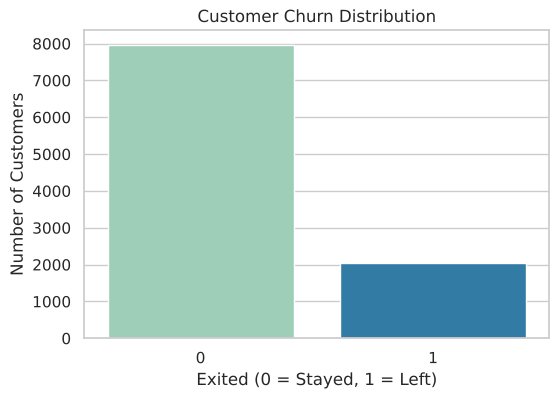
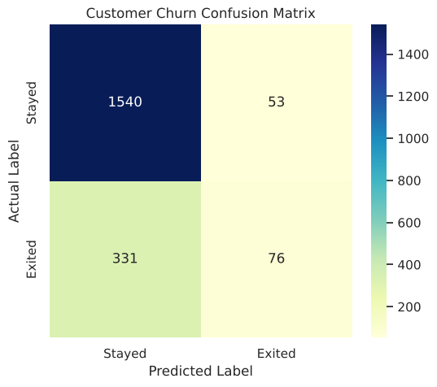
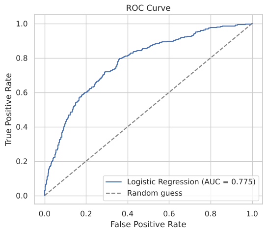
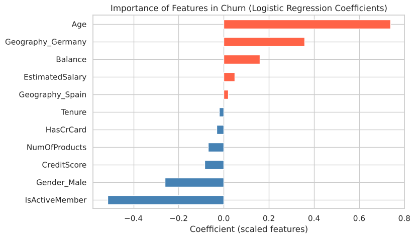

# 🏦 Bank Customer Churn Prediction

A beginner-friendly classification project using Python, Pandas, Seaborn, Matplotlib, and Scikit-Learn.

    

## 📌 Table of Contents

- [📖 About the Project](#-about-the-project)
- [🎯 Project Objectives](#-project-objectives)
- [📊 Dataset Overview](#-dataset-overview)
- [🛠️ Technologies and Libraries](#️-technologies-and-libraries)
- [📁 Project Structure](#-project-structure)
- [⚙️ Getting Started](#️-getting-started)
- [🔍 Analysis Workflow](#-analysis-workflow)
- [📈 Results and Visualizations](#-results-and-visualizations)
- [🚀 Future Improvements](#-future-improvements)
- [👨‍💻 Author](#-author)

## 📖 About the Project

This project builds a machine learning model that predicts whether a bank customer will **leave the bank (churn)** or **stay**, using the Churn Modelling dataset.

The notebook walks through a practical workflow: loading and inspecting the data, checking data quality, removing identifier columns, one-hot encoding categorical features, splitting and scaling the data, training a Logistic Regression model, and evaluating it with accuracy, precision, recall, F1-score, ROC-AUC, a confusion matrix, and a ROC curve.

This project was completed as **Task 3** of the Data Science & Analytics internship at **DevelopersHub Corporation**.

## 🎯 Project Objectives

The main objectives are to:

- Load and inspect the Churn Modelling dataset.
- Check for missing values, duplicate records, and class imbalance.
- Remove columns that do not help prediction (`RowNumber`, `CustomerId`, `Surname`).
- Encode categorical features (`Geography`, `Gender`) with one-hot encoding.
- Split the data into training and test sets and scale the features.
- Train a Logistic Regression classifier.
- Evaluate the model beyond accuracy (precision, recall, F1-score, ROC-AUC).
- Identify which customer features influence churn the most.

## 📊 Dataset Overview

The dataset is included in this folder as `Churn_Modelling.csv`.

It contains **10,000 customers** and **14 columns**. There are no missing values and no duplicate rows.

| Column | Description |
|:--|:--|
| RowNumber | Row index (dropped) |
| CustomerId | Unique customer ID (dropped) |
| Surname | Customer surname (dropped) |
| CreditScore | Customer credit score |
| Geography | Country of the customer (France, Germany, Spain) |
| Gender | Female / Male |
| Age | Customer age |
| Tenure | Number of years with the bank |
| Balance | Account balance |
| NumOfProducts | Number of bank products used |
| HasCrCard | Whether the customer has a credit card (0/1) |
| IsActiveMember | Whether the customer is an active member (0/1) |
| EstimatedSalary | Estimated annual salary |
| **Exited** | **Target: 1 = customer left, 0 = customer stayed** |

**Class balance:** about 79.6% of customers stayed and 20.4% left, so the dataset is **imbalanced**.

## 🛠️ Technologies and Libraries

| Technology | Purpose |
|:--|:--|
| Python | Core programming language |
| Pandas / NumPy | Data loading, cleaning, and encoding |
| Matplotlib / Seaborn | Visualization |
| Scikit-Learn | Train/test split, scaling, Logistic Regression, evaluation metrics |
| Jupyter | Interactive notebook environment |

## 📁 Project Structure

```
churn-prediction/
├── README.md
├── churn_prediction.ipynb
├── Churn_Modelling.csv
├── requirements.txt
└── images/
    ├── 01_class_distribution.png
    ├── 02_confusion_matrix.png
    ├── 03_roc_curve.png
    └── 04_feature_importance.png
```

| File | Description |
|:--|:--|
| README.md | Project documentation and setup instructions |
| churn_prediction.ipynb | Notebook with the analysis, code, and visualizations |
| Churn_Modelling.csv | Dataset used in the project |
| requirements.txt | List of required Python libraries |
| images/ | Result plots shown in this README |

## ⚙️ Getting Started

Follow these steps to run the project locally.

### 1. Clone the Repository

Replace the placeholder with the actual GitHub repository URL.

```bash
git clone <YOUR_REPOSITORY_URL>
```

Navigate to the project directory:

```bash
cd churn-prediction
```

### 2. Create a Virtual Environment (Recommended)

```bash
python -m venv .venv
```

Activate it on Windows:

```bash
.venv\Scripts\activate
```

On macOS or Linux:

```bash
source .venv/bin/activate
```

### 3. Install Dependencies

```bash
python -m pip install -r requirements.txt
```

The dependency file contains:

```
pandas
numpy
matplotlib
seaborn
scikit-learn
jupyter
```

### 4. Launch Jupyter Notebook

```bash
jupyter notebook churn_prediction.ipynb
```

Run the cells from top to bottom. Keep `Churn_Modelling.csv` in the same folder as the notebook.

> **Note:** A compatible Python installation is required. The dependency file does not pin specific package versions.

## 🔍 Analysis Workflow

### 1. Import Libraries
Import Pandas, NumPy, Matplotlib, Seaborn, and the required Scikit-Learn tools.

### 2. Load and Inspect the Data
- Load `Churn_Modelling.csv` into a DataFrame.
- Preview the data with `head()` and inspect the structure with `info()`.
- Check missing values, duplicate rows, and the churn distribution.

### 3. Clean and Encode
- Drop `RowNumber`, `CustomerId`, and `Surname`.
- One-hot encode `Geography` and `Gender` (with `drop_first=True`), so the countries are not given a false order.

### 4. Split and Scale
- 80% training / 20% testing split with `random_state=42` and stratification (keeps the same churn ratio in both sets).
- Standardize features with `StandardScaler` (fit on the training data only).

### 5. Train and Evaluate
- Train a Logistic Regression model (`max_iter=1000`).
- Evaluate with accuracy, precision, recall, F1-score, ROC-AUC, a classification report, a confusion matrix, and a ROC curve.

### 6. Interpret the Model
Use the model coefficients to see which features push a customer towards leaving or staying.

## 📈 Results and Visualizations

Results on the 2,000-customer test set:

| Metric | Value |
|:--|:--|
| Accuracy | 0.808 |
| Precision (churn class) | 0.589 |
| Recall (churn class) | 0.187 |
| F1-score (churn class) | 0.284 |
| ROC-AUC | 0.775 |
| Baseline accuracy (always predict "Stayed") | 0.797 |

The accuracy is only slightly above the baseline, and the model finds only about 19% of the customers who actually leave. This is expected for a basic Logistic Regression on an imbalanced dataset, and it shows why accuracy alone is not enough.

### 1. Class Distribution



About 1 in 5 customers left the bank, so the classes are imbalanced.

### 2. Confusion Matrix



Shows how many customers were correctly and incorrectly classified as staying or leaving.

### 3. ROC Curve



Shows how well the model separates customers who leave from those who stay across all thresholds (AUC ≈ 0.77).

### 4. Feature Importance



Shows the Logistic Regression coefficients on scaled features:

- **Age** has the strongest positive effect: older customers are more likely to leave.
- **IsActiveMember** has the strongest negative effect: active members tend to stay.
- Customers from **Germany** churn more than customers from France.
- Male customers are slightly less likely to leave than female customers.

## 🚀 Future Improvements

Possible extensions for future work:

- Use `class_weight="balanced"` or resampling to handle the class imbalance.
- Tune the decision threshold to improve recall for churners.
- Compare with Random Forest or Gradient Boosting models.
- Add cross-validation and hyperparameter tuning.

These are possible improvements, not features implemented in the current notebook.

## 👨‍💻 Author

**Ahmad Ammar**


