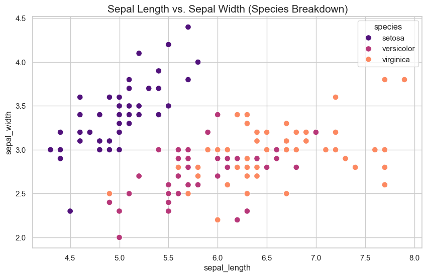
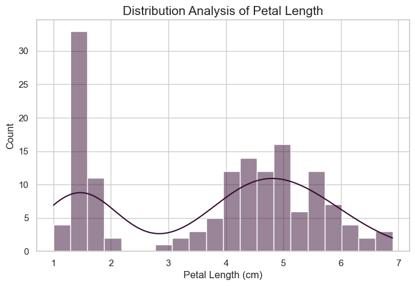

# 🌸 Iris Dataset: Exploratory Data Analysis (EDA)

A beginner-friendly data analysis project using **Python, Pandas, Seaborn and Matplotlib**.

---

## 📖 1. Project Title and Overview

This project explores the classic **Iris flower dataset** using Exploratory Data Analysis (EDA). The goal is to understand the structure of the data, check its quality, summarize the measurements and discover patterns through visualization.

**Problem it addresses:** before any model is built, a dataset must be inspected and cleaned. This notebook shows that first step in a simple, repeatable workflow.

The notebook covers:
- Loading and inspecting the dataset
- Checking missing values and duplicate rows
- Removing duplicates
- Descriptive statistics
- Visualizations (scatter plot, histogram with KDE, box plots)

> This is an EDA project only. It does not train or evaluate a machine-learning model.

---

## 📊 2. Dataset Information

The dataset contains measurements (in cm) of flowers from three species: *Iris setosa*, *Iris versicolor* and *Iris virginica*.

It is loaded directly with Seaborn:

```python
iris_df = sns.load_dataset('iris')
```

| Column | Description | Type |
|---|---|---|
| `sepal_length` | Length of the sepal | Numerical |
| `sepal_width` | Width of the sepal | Numerical |
| `petal_length` | Length of the petal | Numerical |
| `petal_width` | Width of the petal | Numerical |
| `species` | Iris species | Categorical |

| Metric | Result |
|---|---|
| Initial records | 150 |
| Columns | 5 |
| Missing values | 0 |
| Duplicate rows | 1 |
| Records after duplicate removal | 149 |

**Note:** there is no local CSV file in this project. Seaborn downloads the dataset, so an internet connection may be needed the first time you run the notebook.

---

## 🛠️ 3. Technologies Used

| Technology | Purpose |
|---|---|
| Python | Core programming language |
| Pandas | Data inspection, cleaning and statistics |
| Seaborn | Dataset loading and statistical plots |
| Matplotlib | Plot creation and customization |
| Jupyter Notebook | Interactive analysis |

---

## 🧹 4. Data Cleaning and Analysis

1. **Load and inspect**: view the first rows with `head()`, check size and column types with `info()`.
2. **Missing values**: `isnull().sum()` reports 0 missing values in all 5 columns.
3. **Duplicates**: `duplicated().sum()` finds 1 duplicate row, which is removed (150 → 149 records).
4. **Descriptive statistics**: `describe()` gives count, mean, standard deviation, min, max and quartiles for the 4 numerical features.

---

## 📈 5. Visualizations and Key Insights

| Plot | What it shows |
|---|---|
| Scatter plot: sepal length vs sepal width (colored by species) | Relationship between the two sepal measurements and how species are spread |
| Histogram with KDE: petal length | Distribution and shape of petal length |
| Horizontal box plots: all numerical features | Spread of each feature and possible outliers |






**Key findings**

1. The dataset has 150 records and 5 columns, with no missing values.
2. One duplicate row was found and removed, leaving 149 records.
3. *Iris setosa* appears clearly separated from the other two species in the sepal scatter plot.
4. After cleaning (149 records), the average measurements are: sepal length 5.84 cm, sepal width 3.06 cm, petal length 3.75 cm and petal width 1.19 cm.
5. Petal length varies the most (standard deviation 1.77, range 1.0 to 6.9 cm). Sepal width varies the least (standard deviation 0.44, range 2.0 to 4.4 cm).
6. The median petal length (4.3 cm) is higher than its mean (3.75 cm), which shows the values are not evenly spread around the average.
7. The histogram and box plots give a visual overview of each measurement's spread.
8. Box plots may show points far from the rest of the data. These are only candidates for further checking and are not automatically errors.

---

## 📁 6. Project Structure

```
iris-eda/
├── README.md
├── iris_eda.ipynb
├── requirements.txt
└── .gitignore
```

| File | Purpose |
|---|---|
| `README.md` | Project documentation |
| `iris_eda.ipynb` | Notebook with code, analysis and plots |
| `requirements.txt` | Python libraries needed |
| `.gitignore` | Files excluded from Git |

---

## ⚙️ 7. Installation and Setup

**Requirements:** Python 3 and a terminal.

1. Get the project folder (download it, or clone the repository):

```bash
git clone https://github.com/<YOUR-GITHUB-USERNAME>/iris-eda.git
cd iris-eda
```

2. (Recommended) create a virtual environment:

```bash
python -m venv .venv
```

Activate it:
- Windows: `.venv\Scripts\activate`
- macOS / Linux: `source .venv/bin/activate`

3. Install the libraries:

```bash
pip install -r requirements.txt
```

`requirements.txt` contains:

```
pandas
seaborn
matplotlib
jupyter
```

---

## 🚀 8. How to Run the Project

```bash
jupyter notebook iris_eda.ipynb
```

Then:
1. The notebook opens in your browser.
2. Run the cells in order, from top to bottom.
3. Check the outputs, statistics and plots.

If the dataset does not load, check your internet connection.

---

## ✅ 9. Conclusion and Future Improvements

**What I learned**
- Loading and inspecting structured data with Pandas
- Checking for missing values and duplicates
- Cleaning data before analysis
- Summarizing numerical features
- Creating and reading scatter plots, histograms and box plots

**Future improvements** (not yet implemented)
- Species-wise descriptive statistics
- Correlation heatmap
- Systematic outlier investigation
- Saving plots in an `images/` folder
- Pinning library versions in `requirements.txt`

---

## 📚 10. Credits and Data Source

- Dataset: Iris dataset, loaded through [Seaborn's example data](https://github.com/mwaskom/seaborn-data)
- Original source: [UCI Machine Learning Repository: Iris](https://archive.ics.uci.edu/dataset/53/iris) (check the license on the UCI page)
- Libraries: [Pandas](https://pandas.pydata.org/), [Seaborn](https://seaborn.pydata.org/), [Matplotlib](https://matplotlib.org/), [Jupyter](https://jupyter.org/)

---

## 👨‍💻 Author

**[Ahmad Ammar]**

Built as a hands-on project to practice Python-based exploratory data analysis.
