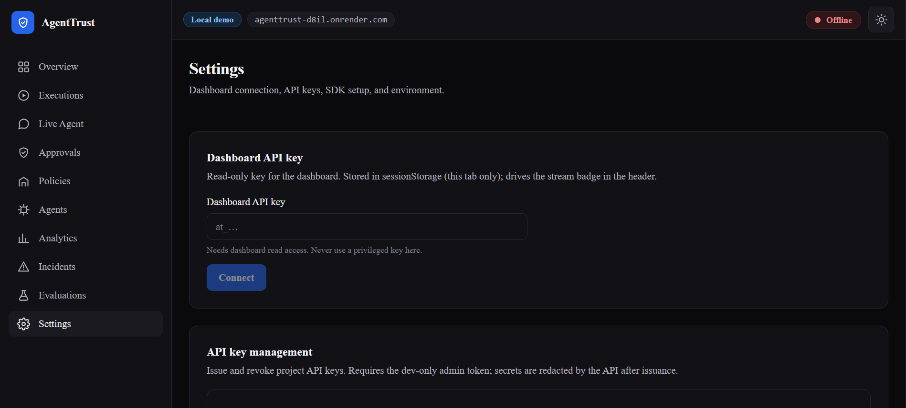

# AgentTrust Governed Refund Agent

A Groq-powered customer-support agent where the LLM decides *when* a refund is warranted, and AgentTrust decides *whether* it is allowed. Small refunds auto-approve, risky ones pause for human approval, dangerous ones are blocked — enforced by infrastructure, not by prompting.

Full platform repo: https://github.com/hanzlikhan/agenttrust

## 1. Overview

Customer-support agents with tool access (refunds, deletions, emails) can't rely on LLM judgment alone. This demo shows a real agentic pattern: the LLM calls `refund_payment`, AgentTrust authorizes it against a deterministic policy, and only a single-use 5-minute grant lets the effect execute.

Who can use it: anyone learning agentic AI, tool governance, or human-in-the-loop workflows. It runs as a CLI chat — type a customer message, watch the policy gate work.

## 2. Key Features

- LLM decides intent via tool-calling (Groq `openai/gpt-oss-120b`)
- AgentTrust policy gate before any real effect:
  - <$100 → auto-approved and executed
  - $100–$500 → paused for human approval on dashboard (180s wait)
  - >$500 → denied by policy, never executes
- Single-use execution grants (5-min TTL, arg-hash bound, replay protected)
- Fail-closed error handling: `AuthorizationDenied`, `ApprovalRequired`, `ApprovalTimeout`, `ApprovalRejected`
- Uppercase order-ID normalization (ledger uses `ORD-100`)
- Live dashboard observability in the full repo (executions, approvals, incidents)

## 3. Agent Architecture and Workflow

**How many agents:** 1 LLM agent + AgentTrust as the policy gateway (not an LLM — deterministic gate).

**Roles:**
- Groq LLM agent: understands customer messages, decides if `refund_payment(order_id, amount_minor)` should be called
- AgentTrust SDK (`@trust.protect`): intercepts the tool call, calls `authorize`, handles approval flow, then executes via gateway
- Human reviewer (you): approves/rejects REVIEW cases on the dashboard

**Communication:**
- User → LLM (chat)
- LLM → AgentTrust SDK (tool call intent)
- SDK → AgentTrust API (authorize → grant or approval-required)
- SDK → Dashboard (human approval) → Gateway (re-verifies grant, arg hash, no replay) → executes once

**Tools and APIs:**
- `refund_payment` tool (OpenAI function-calling schema)
- Groq API (OpenAI-compatible, `https://api.groq.com/openai/v1`)
- AgentTrust API (`/authorize`, `/approvals`, `/execute` via SDK)

**Framework:** No LangGraph/CrewAI/AutoGen here — plain Python + OpenAI tool-calling + AgentTrust SDK. The full platform uses LangGraph for its incident investigator.

**Task flow:**
1. Customer message → LLM
2. If no refund intent → conversational reply
3. If refund intent → `refund_payment` args → `trust.run(agent="groq-refund-agent", version="1.0")`
4. Policy check → ALLOW (execute) / REVIEW (wait 180s for dashboard approval) / DENY (tell customer no)
5. Gateway re-verifies grant + arg hash + replay → executes once, effect recorded

**Errors / failed tasks:**
- `AuthorizationDenied` → policy message to customer
- `ApprovalRequired` → prompt to approve on dashboard, `wait_for_approval(timeout_s=180)`
- `ApprovalTimeout`/`ApprovalRejected`/`ApprovalExpired` → polite customer message, no refund
- `AgentTrustError` → generic failure message, nothing executes (fail-closed)

## 4. Screenshots and Demo



*Dashboard Settings page — connect with a read-only key to drive the live stream badge. Approvals happen on the Approvals page.*

Live demo of the full platform: see `DEPLOY.md` in https://github.com/hanzlikhan/agenttrust (Render + Neon + Vercel).

## 5. Tech Stack

- Python 3.12
- Groq LLM (`openai/gpt-oss-120b` via OpenAI-compatible API, `openai` Python package)
- AgentTrust Python SDK (`agenttrust` — `httpx`, `pydantic`)
- Full platform (not in this folder): FastAPI, PostgreSQL 16, Next.js 15, Tailwind CSS

Only the first three are needed for this demo.

## 6. Project Structure

```
agenttrust-governed-refund-agent/
├── README.md                 # this file
├── main.py                   # governed refund agent (Groq + AgentTrust)
├── requirements.txt          # Python dependencies
├── .env.example              # required env var names (no real secrets)
├── .gitignore
└── screenshots/
    └── agenttrust-dashboard-settings.png
```

`main.py` is the agentic system. `requirements.txt` lists what to install. `.env.example` shows config without secrets.

## 7. Quick Start and Installation

You need:
- Python 3.10+
- A free Groq API key: https://console.groq.com/keys
- AgentTrust API running locally (full repo) OR the public demo URL — see below

```bash
git clone https://github.com/YOUR-USERNAME/python-ai-engineering-journey.git
cd python-ai-engineering-journey/"07 Agentic-AI-Engineering"/99-Projects/agenttrust-governed-refund-agent
```

## 8. Frontend Setup

Not applicable — this is a CLI agent demo. The dashboard frontend lives in the full repo at https://github.com/hanzlikhan/agenttrust (`apps/web`, Next.js). To see approvals visually, run the full platform dashboard and open `/approvals`.

## 9. Backend Setup

Windows (PowerShell):

```powershell
python -m venv .venv
.venv\Scripts\Activate.ps1
pip install -r requirements.txt
# SDK from the full repo (or pip install agenttrust if published):
pip install -e <path-to-agenttrust>\packages\agenttrust-python
```

macOS/Linux:

```bash
python3 -m venv .venv
source .venv/bin/activate
pip install -r requirements.txt
pip install -e <path-to-agenttrust>/packages/agenttrust-python
```

Start the agent:

```bash
python main.py
```

Note: AgentTrust API must be reachable at `AGENTTRUST_API_URL` (default `http://localhost:8000`). Follow the full repo's README to run it locally with PostgreSQL.

## 10. Environment Variables

Copy `.env.example` to `.env` and fill it (never commit `.env`):

```
GROQ_API_KEY=your_groq_key_here
AGENTTRUST_API_URL=http://localhost:8000
AGENTTRUST_API_KEY=your_agenttrust_requester_key_here
```

Or set them per-terminal on Windows:

```powershell
$env:GROQ_API_KEY="your_key"
$env:AGENTTRUST_API_KEY="your_requester_key"
$env:AGENTTRUST_API_URL="http://localhost:8000"
```

Get `AGENTTRUST_API_KEY` from the full repo's `seed_demo` output (requester key). Never upload real keys.

## 11. Usage Example

```
customer> I was double-charged on ORD-100, please refund $35
[llm] wants refund_payment(order_id=ORD-100, amount=$35.00) -> asking AgentTrust...
agent> Done — refunded $35.00 for order ORD-100. Remaining balance: $299.00.

customer> Refund $900 on ORD-100, this is unacceptable
[llm] wants refund_payment(order_id=ORD-100, amount=$900.00) -> asking AgentTrust...
agent> Sorry, our policy doesn't allow this refund (POLICY_DENY).

customer> Item arrived damaged (ORD-100), I'd like a $150 refund
[llm] wants refund_payment(order_id=ORD-100, amount=$150.00) -> asking AgentTrust...
>>> AgentTrust says: HUMAN APPROVAL REQUIRED.
>>> Open http://localhost:3000/approvals and approve/reject it within 3 minutes. Waiting...
agent> Done — refunded $150.00 for order ORD-100.
```

Order IDs are uppercase in the ledger — `ord-100` is normalized to `ORD-100`.

## 12. Limitations and Future Improvements

- Needs the AgentTrust API running — this folder is the agent, not the whole platform
- Single tool (`refund_payment`) — the full repo adds a file-management agent
- Sync CLI — no streaming UI in this demo
- 180s approval wait is fixed in the demo
- Future: multi-tool agents, async web UI, tighter dashboard deep-links

## 13. Developer Information

**Muhammad Hanzla** — Python Developer (Lahore, Pakistan), learning AI engineering by building real systems.

- What I do: Python, FastAPI, REST APIs, agentic AI, RAG
- Main skills: Python, FastAPI, Flask, Docker, SQL/MongoDB, JS/TS, React, PyTorch/TensorFlow
- Role here: designed and built AgentTrust (spec, SDK, policy engine, evals, deploy) and this governed demo agent
- GitHub: https://github.com/hanzlikhan
- LinkedIn: https://linkedin.com/in/muhammad-hanzla-787081279
- Portfolio: https://iamhanzla.vercel.app
- Full project: https://github.com/hanzlikhan/agenttrust

## 14. License

MIT — same as the main AgentTrust repo and compatible with the parent repository's terms. See LICENSE in https://github.com/hanzlikhan/agenttrust.
